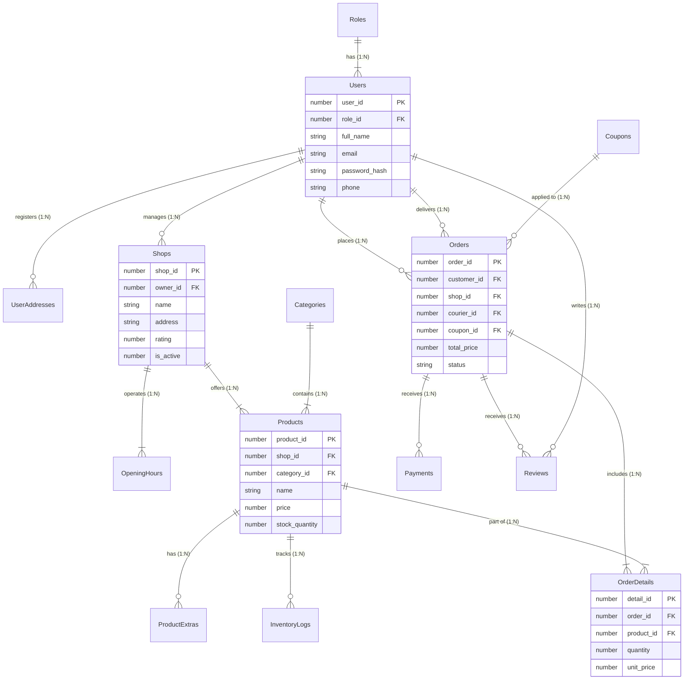

# 🌸 The Flower Hub — Multi-Vendor Delivery Database System


**The Flower Hub**, bağımsız yerel çiçekçileri, butik hediye dükkanlarını, kuryeleri ve müşterileri tek bir ekosistemde bir araya getiren çok satıcılı (multi-vendor) bir e-ticaret veritabanı platformudur. Proje; parçalanmış yerel teslimat kanallarını tek bir mimaride birleştirerek sipariş işleme, ürün özelleştirme, gerçek zamanlı stok yönetimi ve finansal şeffaflığı tam otomasyonla sağlamak amacıyla **Oracle SQL** ve **PL/SQL** kullanılarak geliştirilmiştir.

---

## 📑 Akademik Bilgiler & Dokümantasyon

* **Üniversite:** Bandırma Onyedi Eylül Üniversitesi
* **Ders:** Veritabanı Yönetim Sistemleri (DBMS)
* **Dönem:** 2025–2026 Bahar Dönemi
* **Danışman:** Arş. Gör. N. Güliz Çakır
* **Proje Tasarım Raporu:** Projeye ait tüm kavramsal tasarım, normalizasyon ve sorgu analizlerini içeren resmi rapora [`docs/DBMS_Project_Report.pdf`]([DBMS_Project.pdf](https://github.com/user-attachments/files/34202725/DBMS_Project.pdf)
) dosyasından ulaşabilirsiniz.

---

## 👥 Proje Ekibi & Görev Dağılımı (Team Contributions)

Proje yaşam döngüsünün her aşaması ekip üyeleri arasında modüler olarak paylaştırılmış ve uygulanmıştır:

| Ekip Üyesi | Öğrenci No | Üstlendiği Temel Görevler & Modüller |
| :--- | :--- | :--- |
| **Cansu Çoşkun** | 2311504270 | Ürün kataloğu (`Products`), ek ürün/özelleştirme seçenekleri (`ProductExtras`) ve stok denetim defteri (`InventoryLogs`) DDL/DML yapıları; satır seviyesinde kilitli stok kontrolü ve anlık delta loglama tetikleyicileri (`trg_process_order_stock`, `trg_track_inventory_changes`); 3NF normalizasyon süreci, ER modelleme ve analitik iş sorguları. |
| **Esma Arıcı** | 2311504259 | Sistem iş senaryosunun kurgulanması; sipariş motoru (`Orders`) ve satır bazlı sipariş detayları (`OrderDetails`) tabloları; sipariş oluşturma ve detaylandırma adımlarını tek bir transaction altında güvenceye alan `processcheckout` saklı yordamı (PL/SQL Stored Procedure); ER modelleme ve 3NF analizi. |
| **Zeynep Özbudak** | 2311504225 | Promosyon/kupon motoru (`Coupons`), ödeme altyapısı (`Payments`) ve müşteri değerlendirme sistemi (`Reviews`) DDL kısıtları ve mock veri üretimi; ER diyagramı kurgusu, normalizasyon adımları ve ilgili analitik SQL sorguları. |
| **Leen Mahmoud M. Subh** | 2311504309 | Çok satıcılı mağaza profilleri (`Shops`), mağaza haftalık çalışma takvimi (`OpeningHours`) ve kategori taksonomisi (`Categories`) DDL/DML mimarisi; satıcı-mağaza ilişkilendirmeleri, ER tasarımı ve SQL analitiği. |
| **Mustafa Can** | 2211504074 | Rol Tabanlı Erişim Kontrolü (RBAC) yetkilendirme modeli (`Roles`, `Users`); çoklu teslimat adres yönetimi (`UserAddresses`) DDL/DML tabloları; senaryo kurgusu ve kullanıcı-rol ilişkileri mimarisi. |

---

## 🏛️ Mimari Tasarım & Öne Çıkan Özellikler

### 1. Rol Tabanlı Erişim Kontrolü (RBAC)
Kullanıcılar tablosunda statik kolonlar veya boolean bayraklar tutmak yerine, bağımsız bir `Roles` entitesi kurgulanmıştır. Bu yapı sayesinde `Admin`, `Customer`, `Vendor` ve `Courier` rolleri net bir şekilde ayrıştırılmış; sisteme yeni kullanıcı tipleri eklendiğinde şema değişikliği gerektirmeyen esnek bir altyapı sağlanmıştır.

### 2. Üçüncü Normal Form (3NF) & Finansal Tutarlılık
Sistem UNF formundan başlanarak fonksiyonel bağımlılıklar incelenmiş ve 3NF seviyesine getirilmiştir:
* Kısmi bağımlılıklar (`Partial Dependencies`) ayrıştırılarak güncelleme anomalileri engellenmiştir.
* Geçişli bağımlılıklar (`Transitive Dependencies`) kırılarak müşteri ve sipariş ilişkisi ayrıklaştırılmıştır.
* `Products` tablosunda ürünün anlık piyasa fiyatı tutulurken, `OrderDetails` tablosunda sipariş anındaki tarihsel fiyat (`unit_price`) saklanmıştır; bu durum denormalizasyon değil, mali kayıt tutarlılığı gereğidir.

### 3. PL/SQL Tabanlı Akıllı Stok ve İşlem Otomasyonu
* **`trg_process_order_stock`**: Yeni bir `OrderDetails` kaydı girilmeden hemen önce tetiklenir (`BEFORE INSERT`). `SELECT ... FOR UPDATE` ile hedef ürünün satırını veritabanı seviyesinde kilitler; yeterli stok yoksa işlemi `RAISE_APPLICATION_ERROR` ile iptal ederek rollback eder, yeterli stok varsa sipariş miktarını mevcut stoktan anında düşer.
* **`trg_track_inventory_changes`**: Ürün stoğu güncellendiğinde tetiklenir (`AFTER UPDATE`). Net stok değişimini (`:NEW.stock_quantity - :OLD.stock_quantity`), işlem tipini ve zaman damgasını `InventoryLogs` tablosuna değişmez bir kayıt (audit trail) olarak yazar.
* **`processcheckout`**: Sipariş üst kaydı (`Orders`) ile ilişkili ürün satırının (`OrderDetails`) oluşturulmasını tek bir güvenli mantıksal işlem (transaction) altında yürütür.

---

## 🗺️ Varlık-İlişki Diyagramı (ERD)



---

## 🗂️ Depo Dizin Yapısı

```text
flower-hub-db/
├── README.md                     # Proje dokümantasyonu ve mimari özeti
├── docs/
│   └── DBMS_Project_Report.pdf   # Resmî proje raporu
├── schema/
│   ├── 00_cleanup.sql            # Teardown DDL (DROP TABLE CASCADE CONSTRAINTS)
│   └── 01_tables.sql             # 14 entite, anahtarlar ve CHECK kısıtları
├── data/
│   └── 02_seed_data.sql          # Test ve simülasyon verileri
├── logic/
│   ├── 03_procedures.sql         # PL/SQL Checkout yordamı (processcheckout)
│   └── 04_triggers.sql           # Stok kontrol ve loglama tetikleyicileri
├── queries/
│   └── 05_analytics.sql          # Raporda yer alan 10 iş ve analitik SQL sorgusu
└── init.sql                      # Tüm veritabanını sıfırdan kuran ana script
```

---

## 📊 Raporlanan Analitik İş Problemleri (SQL Queries)

`queries/05_analytics.sql` dosyası işletme operasyonlarını destekleyen 10 temel analitik sorguyu barındırır:

1. **Aktif Kullanıcı Katılımı:** Müşteri ve satıcıların kayıtlı teslimat adresi sayıları analizi.
2. **Eksik Profil Tespiti:** Henüz adres tanımlamamış müşterilere bildirim tetikleme listesi.
3. **Satıcı Performans Raporu:** Toplam cirosu 500 birimi aşan en yüksek hacimli çiçekçiler.
4. **Sipariş Kuyruğu Takibi:** Teslimat darboğazını önlemek için bekleyen (`PENDING`) siparişler.
5. **Öne Çıkan Kategoriler:** Ortalama mağaza puanı 4.0 üzerinde olan vitrin kategorileri.
6. **Haftanın Her Günü Açık Mağazalar:** Operasyonel denetim için kesintisiz hizmet veren satıcı rehberi.
7. **Ödeme Kanalı Analitiği:** Ödeme yöntemlerine göre başarılı işlem adedi, ciro ve müşteri memnuniyeti.
8. **Kritik Stok Uyarıları:** Stok miktarı 20 adedin altına düşen ürünler için ikmal listesi.
9. **Kurye İletişim Rehberi:** Acil lojistik koordinasyonu için aktif kurye rehberi.
10. **Kritik Şikayet Kayıtları:** Müşterilerden 1 yıldız alan problemli sipariş ve ürünlerin tespiti.

---

## 🚀 Kurulum & Çalıştırma (Getting Started)

Tüm şemayı, kısıtları, seed verileri, PL/SQL trigger ve prosedürlerini tek bir komutla ayağa kaldırmak için **Oracle SQL Developer**, **SQLcl** veya **SQL*Plus** konsolunda ana kurulum betiğini çalıştırın:

```sql
@init.sql
```

---

## 📄 Lisans

Bu proje akademik ve eğitim amaçlı geliştirilmiş olup [MIT Lisansı](LICENSE) kapsamında lisanslanmıştır.
